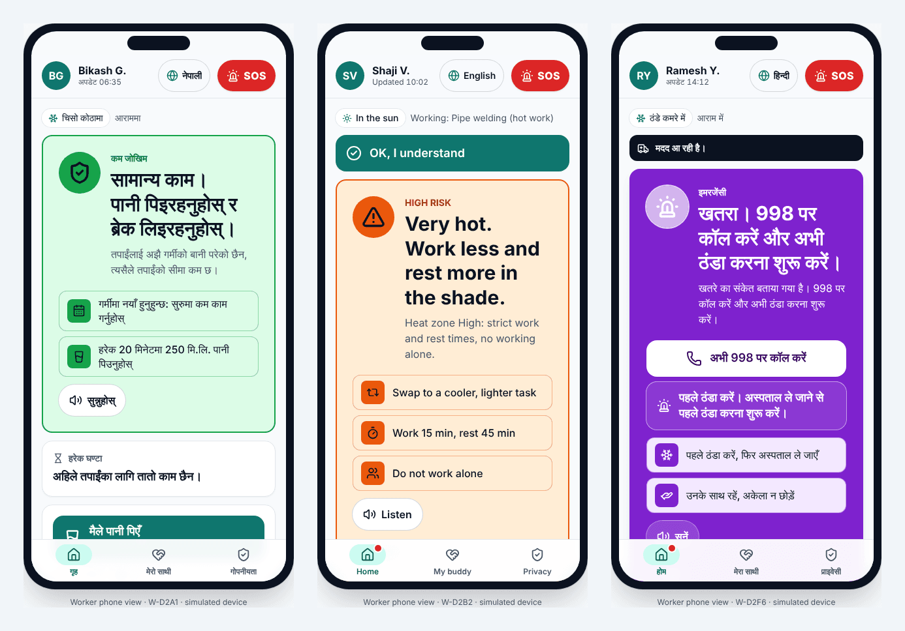
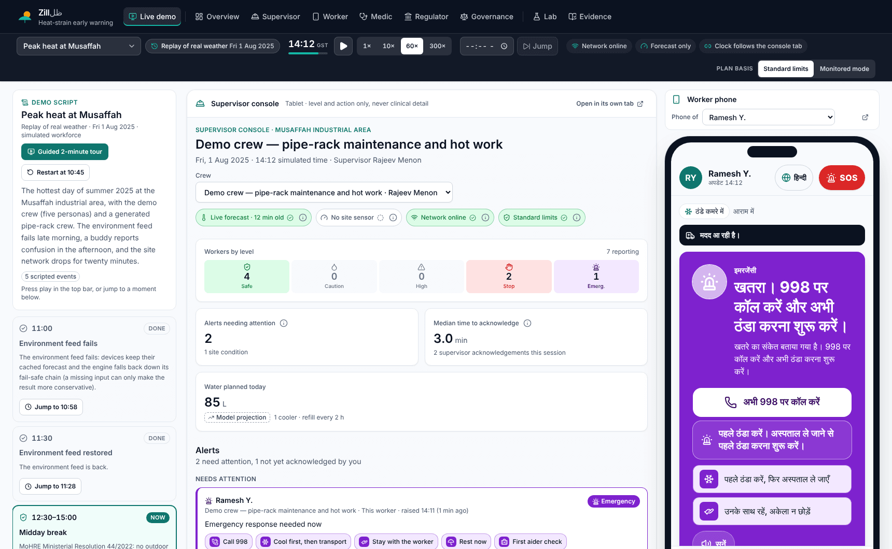
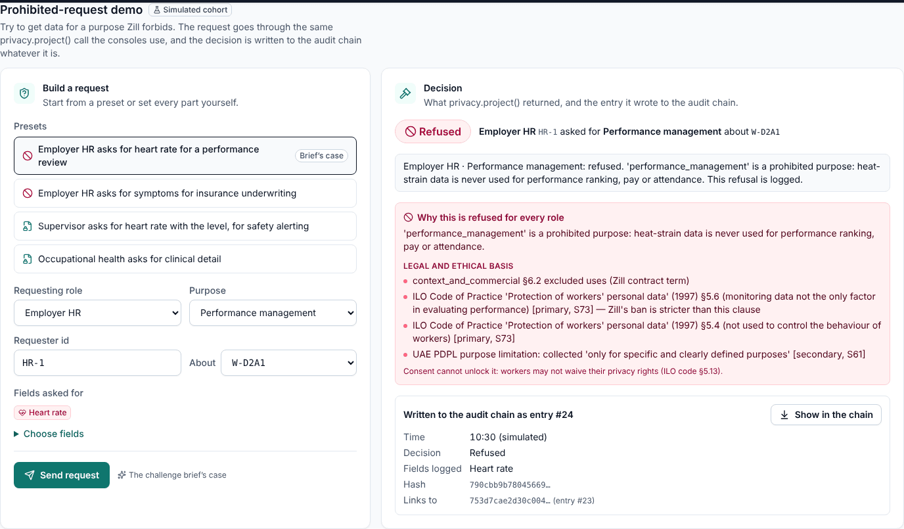

# Zill (ظل, "shade")

**Worker-first heat-strain early warning for outdoor and industrial workers in Abu Dhabi.**
Future Health Digital Innovation Challenge — Challenge 07: Climate-Resilient Worker Health.

**Live demo:** https://youssef123ya.github.io/Future-Health-Digital-Innovation-Challenge/ (runs in the browser with
built-in demo data; rebuilt on every push to `main`).
**Guided 2-minute demo:** [open it here](https://youssef123ya.github.io/Future-Health-Digital-Innovation-Challenge/#/demo?tour=1),
or press **Take the 2-minute guided demo** on the overview.

> Prototype under active development. Not a medical device. Simulated results are projections under stated
> assumptions, not measured health outcomes.



## What it does

Zill turns site weather, each worker's task and clothing, optional wearable data and simple symptom check-ins into one
graded warning level (safe, caution, high, stop) with a concrete action ("rest 15 min in the cooled cabin", "drink
250 mL", "call 998"). It does this per worker, in the worker's own language, with privacy built into the architecture.

- **Dynamic heat-risk assessment.** WBGT (Liljegren), ISO 7933:2023 Predicted Heat Strain projections, NIOSH REL/RAL and
  ACGIH work/rest limits, Thermal Work Limit, and the Abu Dhabi ADOSH-SF Code of Practice 11.0 v4.0 zones and midday
  break, combined in one risk engine with six channels: environment, regulation, projection, physiology, symptoms and
  hydration.
- **Graded, multilingual warnings.** Eight languages (Arabic, English, Hindi, Urdu, Bengali, Malayalam, Tagalog, Nepali),
  colour + pictogram + text + read-aloud, with an ANSI/ISA-18.2-style deadband so warnings do not flap.
- **Worker-first governance.** Clinical data stays on the worker's phone. Supervisors see a level, an action and a
  non-clinical reason only. Every access is checked against a role and purpose matrix and written to a hash-chained
  audit log. Consent is granular and revocable, and disciplinary use is prohibited.
- **Field-ready.** Works offline as a PWA. It degrades to protective defaults when the wearable, the site sensor, the
  forecast or the network fails.
- **Supervisor decision support.** A day planner screens each task-hour against the limits, moves heavy work to cooler
  hours and plans water and rest.
- **Measured, not asserted.** Reference agreement tests, six years of real Abu Dhabi weather, archived-forecast skill and
  a closed-loop simulated cohort whose ground truth comes from an independent physiological model (Gagge two-node), so
  the warning engine is never graded against itself.

## How Zill answers Challenge 07

| The challenge asks for | What Zill does | Where to see it |
|---|---|---|
| 1. Dynamic heat-risk assessment | Weather → heat indices → personal limits (acclimatisation, clothing, declared factors) → ISO 7933 projection → optional wearable and check-ins, fused into one level per worker every minute | Worker phone; guided demo steps 1–2 |
| 2. Clear, graded, multilingual warnings | Five levels, colour + pictogram + text + voice, one concrete action with minutes or millilitres; red-flag symptoms go straight to EMERGENCY (call 998, cool first) | Worker phone (8 languages); demo steps 2 and 5 |
| 3. Worker-first governance | On-device clinical data, role × purpose access matrix, prohibited purposes (performance, discipline, insurance, visa), revocable consent with receipts, hash-chained audit the worker can read | Governance centre, phone Privacy tab; demo steps 6 and 8 |
| 4. Field-ready operation | Offline PWA; fail-safe input chain (a missing sensor or forecast can only make advice stricter); phones keep warning when the network drops; battery saver | Peak-day replay at 11:00 and 15:30; demo steps 4 and 7 |
| 5. Supervisor decision support | Crew board with levels and actions but no individual numbers, pooled "not cleared for heat work" reason, reassign control, day planner, water logistics | Supervisor console; demo step 3 |
| 6. Safety and productivity measures | Reference agreement, real-weather exposure 2020–2025, forecast skill, simulated cohort with events per 1,000 worker-shifts *and* the work cost, shadow-mode alert lead time and false alarms | Evidence; demo step 9 |



## Screens

| Route | For | What it shows |
|---|---|---|
| `#/` | Everyone | The problem with cited figures, how Zill works, live conditions at the five sites, the guided demo |
| `#/demo` | Presenters | Supervisor console and one worker's phone side by side on one clock, with the scenario script |
| `#/worker/:id` | Workers | The phone: level card, rest/work timer, water, yes/no check-in, buddy check, SOS, privacy and consent, language |
| `#/supervisor` | Crew supervisors | Crew board, alert feed with acknowledgements, site heat strip, day planner |
| `#/medic` | First aiders, occupational health | Active cases, cooling protocol with timer, recovery sign-off, consented clinical detail |
| `#/regulator` | HSE managers, regulators | k-suppressed aggregates, compliance, hours in each heat zone, rule packs |
| `#/governance` | Workers, DPO, auditors | Data-flow inspector, access matrix, prohibited-request demo, audit-chain verifier, consent ledger |
| `#/lab` | Engineers, reviewers | Policy experiments with simulated ground truth (the only screen that shows it) |
| `#/evidence` | Reviewers | Every claim with its provenance and how to reproduce it |

Address options: `?scenario=peak-day|humid-day|mild-day|saadiyat-peak|shade-only`, `&t=HH:mm`, `&speed=1|10|60|300`,
`&play=1`, `&policy=zill_full|zill_monitored|…`, `&lang=ar|en|hi|ur|bn|ml|tl|ne`, `&tour=1`. A phone tab
(`#/worker/<id>`) follows the clock of a console tab over `BroadcastChannel`.



## Status

| Part | State |
|---|---|
| Science engine (`src/engine`) | Implemented and tested |
| Simulation, back-test and simulated cohort (`src/sim`, `scripts/validate`) | Implemented and tested |
| Real-data validation (`scripts/validate`, `public/data/validation`) | Implemented |
| App state, privacy projection, audit, cross-tab sync (`src/state`) | Implemented and tested |
| Product screens (`src/ui/views`): live demo, supervisor console, worker phone, first aid, HSE/regulator, governance centre, lab, evidence | Implemented; view models tested |
| Guided 2-minute demo (`src/ui/tour`), lazy-loaded screens with per-screen error boundaries | Implemented |

The current simulated cohort (v0.3, 45 Abu Dhabi site-days, 333 worker-shifts per arm) projects no excessive heat-strain
events under Zill, against 114 per 1,000 worker-shifts with the midday ban alone and 39 per 1,000 under the ADOSH zone
policy. It also shows a large work cost: about two-thirds less work than the midday-ban baseline. v0.3 added per-person
acclimatisation limits and an opt-in monitored mode (ISO 7243 → ISO 7933 decision flow); neither reduced the cost, which
comes from the day planner. Where that cost comes from, and what a faithful reading of the standards allows, is under
review now. Full tables and caveats: [docs/VALIDATION-COHORT.md](docs/VALIDATION-COHORT.md).

## Run it

Requires Node.js 22 or later.

```bash
npm install
npm run dev          # local app at http://localhost:5173 (guided demo: http://localhost:5173/#/demo?tour=1)
npm test             # unit and integration tests (Vitest)
npm run typecheck    # TypeScript strict mode
npm run validate     # reference agreement, real-weather exposure, forecast skill (about 1 minute)
npx tsx scripts/validate/cohort.ts --medium   # simulated cohort (several minutes)
```

## Documentation

| Document | What it covers |
|---|---|
| [ARCHITECTURE.md](docs/ARCHITECTURE.md) | System design, risk channels, alerts, privacy boundary, views, sync |
| [SCIENCE.md](docs/SCIENCE.md) | The heat-stress models and standards, with citations |
| [GOVERNANCE.md](docs/GOVERNANCE.md) | Consent, access matrix, audit, retention, DPIA |
| [VALIDATION.md](docs/VALIDATION.md) | Reference agreement and real-weather evidence |
| [SIMULATION.md](docs/SIMULATION.md) | The closed-loop simulator and its non-circular ground truth |
| [VALIDATION-COHORT.md](docs/VALIDATION-COHORT.md) | Simulated cohort results, sensitivity and fairness |
| [LIMITATIONS.md](docs/LIMITATIONS.md) | Known limitations and open risks |
| [PILOT.md](docs/PILOT.md) | Pilot protocol and the measures it would collect |

## Data and attribution

Weather data from [Open-Meteo](https://open-meteo.com/) (CC BY 4.0), including the ECMWF IFS and Copernicus ERA5
reanalysis (contains modified Copernicus Climate Change Service information). The free Open-Meteo tier is for
non-commercial use; a deployment would use a commercial weather licence. Workers, crews and physiology in the demo are
a simulated cohort; no real person's data is used.

## License

MIT — see [LICENSE](LICENSE).
